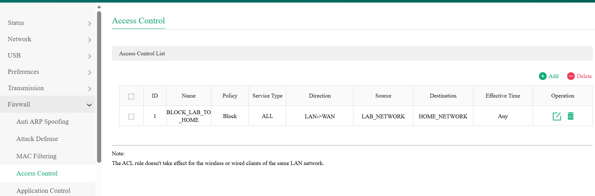
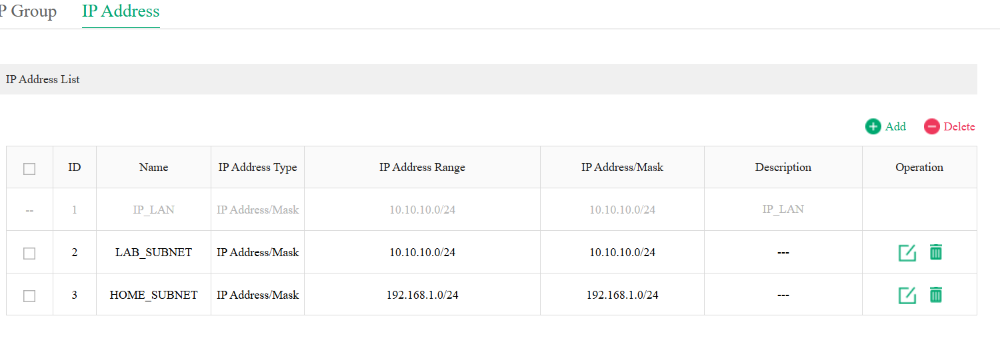

# Router and Firewall Configuration

**Phase:** 01 — Networking | **Status:** Configured and initially tested

## Objective

I wanted my lab systems to receive normal internet connectivity while preventing lab-initiated connections to household devices. This allows experimentation with infrastructure services without exposing my everyday home network to the same changes.

**Topology reference:** [Home Lab Network Diagram](diagrams/Household%20and%20Lab%20Network%20Diagram.png)

## Physical placement and traffic path

```text
Home router (192.168.1.0/24)
    |
Unmanaged household switch
    |
Lab router WAN
Lab router LAN (10.10.10.1/24)
    |
Managed lab switch
    |
Lab hosts and workstation (10.10.10.0/24)
```

The lab router sits between the home and lab networks. It performs routing/NAT toward its upstream WAN connection and applies an access-control policy. The setup has two layers of NAT for outbound internet connections, but NAT itself is not relied on as the security boundary.

## Configured lab network

| Setting | Value |
|---|---|
| Lab subnet | `10.10.10.0/24` |
| Lab gateway | `10.10.10.1` |
| Home subnet protected by rule | `192.168.1.0/24` |
| Initial DHCP service | Lab router |
| Router connection to home | WAN |
| Router connection to lab switch | LAN |

### Captured configuration evidence

**Access-control rule:**



**IP address objects:**



The address objects `LAB_SUBNET` and `HOME_SUBNET` are included in the corresponding `LAB_NETWORK` and `HOME_NETWORK` groups used by the rule (confirmed in the router's IP Group tab).

## Saved access-control rule

I reviewed the router's **Firewall → Access Control** screen and confirmed the following visible rule settings:

| Field | Value |
|---|---|
| Rule ID | `1` |
| Rule name | `BLOCK_LAB_TO_HOME` |
| Policy | `Block` |
| Service type | `ALL` |
| Direction | `LAN → WAN` |
| Source | `LAB_NETWORK` |
| Destination | `HOME_NETWORK` |
| Effective time | `Any` |

The address groups set up during the initial configuration were:

| Address group | IPv4 subnet |
|---|---|
| `LAB_NETWORK` | `10.10.10.0/24` |
| `HOME_NETWORK` | `192.168.1.0/24` |

The saved rule was verified in the router interface; the group subnet values were documented during setup. If these groups are changed later, their actual membership must be checked again.

### What the rule is designed to do

- Match traffic sourced from the lab address group and destined to the household subnet.
- Block matching traffic in the LAN-to-WAN direction at all times for all services covered by the rule.
- Leave permitted lab-to-internet connectivity available.

**Scope:** This rule specifically names `192.168.1.0/24`. It should not be interpreted as an automatic block of every possible upstream/private network. Changes to the home subnet or additional upstream networks require an access-policy review.

## Design reasoning

**Routing versus filtering.** Routing determines where a packet can be forwarded. Firewall filtering decides whether the packet is permitted. The lab router has an upstream path toward the home network, but the access-control rule restricts which packets can use that path.

**Why address groups?** Descriptive groups make the source and destination of a policy easier to read and maintain. The name of a rule does not determine what it blocks: the actual addresses, direction, services, and priority do.

**Rule priority.** In a hypothetical first-match ruleset, a general allow placed above a more specific deny could let unwanted traffic through. Real devices may organize policy evaluation differently, so rule order and effective policy should be verified on the actual router rather than assumed.

**Why a separate router?** Keeping the lab behind a dedicated router also helps separate its local DHCP broadcasts from the household broadcast domain. Later Windows Server DHCP work can be done on the lab side, with careful coordination of whichever service currently hands out leases.

## Validation

Initial setup testing showed:
- Lab internet connectivity worked.
- DNS resolution from the lab worked.
- A household device was reachable from another household device in a baseline test.
- Lab-to-household connectivity attempts using ICMP and a TCP port 80 check were unsuccessful, as expected.
- The configured firewall rule was visible in the router UI.

This is evidence consistent with the intended policy, not a packet-capture-level proof of every possible traffic path. Raw outputs and router drop logs were not archived during the original setup. For test details, see [Network Verification](network-verification.md).

## Evidence to add

- [ ] Sanitized screenshot of `BLOCK_LAB_TO_HOME` in Access Control.
- [ ] Sanitized address-group membership screenshot (optional).
- [ ] Repeatable source/destination test output or firewall logs, with capture date.

## Future exercises

I plan to explore VLAN segmentation, inter-VLAN policy, DHCP migration to Windows Server, and more detailed packet-level troubleshooting. Each will have its own configuration and validation notes.
