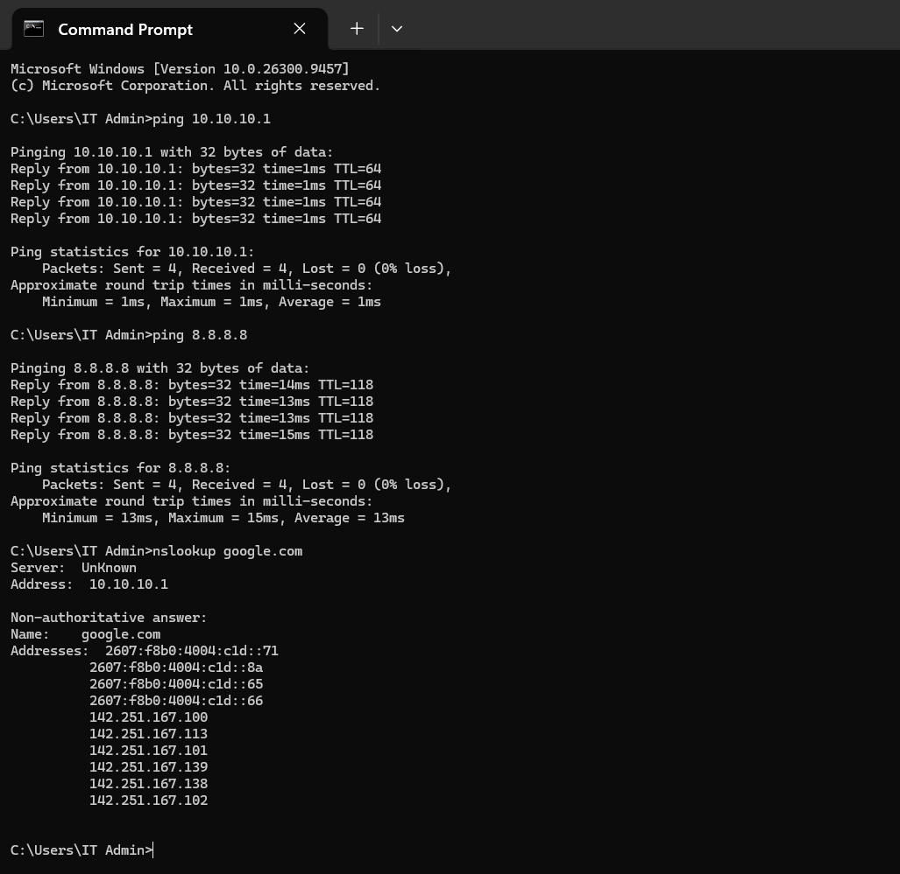
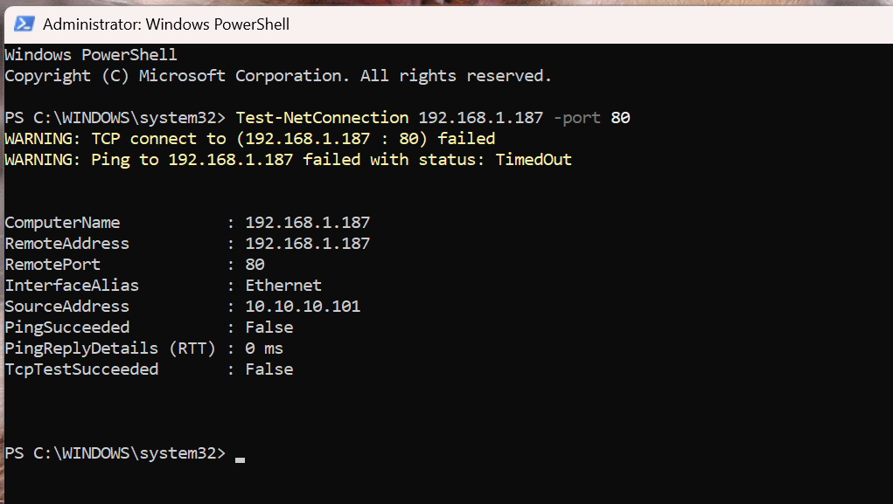
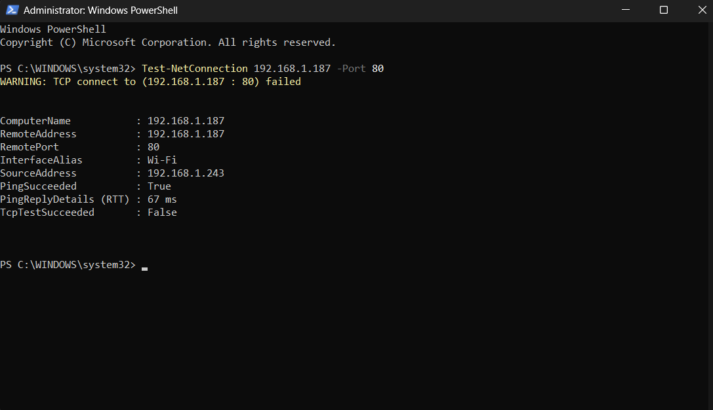

# Network Verification and Testing

**Phase:** 01 — Networking | **Status:** Initial checks completed; raw evidence to be captured later

## Objective

I tested whether the lab could reach its gateway, use external connectivity and DNS, and remain isolated from household devices. I also compared behavior from a household device with behavior from the lab so that a failed connection was not automatically mistaken for a firewall block.

## Environment

| Item | Value |
|---|---|
| Lab subnet | `10.10.10.0/24` |
| Lab gateway | `10.10.10.1` |
| Household subnet | `192.168.1.0/24` |
| Blocking policy | `BLOCK_LAB_TO_HOME` |
| Router rule direction | LAN → WAN |
| Lab test workstation | WS-01 |

## Original setup checks

These results summarize what I observed during initial setup. I did not preserve every command line, destination address, timestamp, or console output, so example commands below are labeled as examples rather than verbatim transcripts.

| Check | Method | Observed outcome |
|---|---|---|
| Router administration | Access router management interface from lab | Accessible |
| Lab internet connectivity | External connectivity check from lab | Working |
| DNS lookup | `nslookup` from lab workstation | Succeeded |
| Household baseline | `ping` between household devices | Connectivity confirmed |
| Lab → household ICMP | `ping` from lab toward household device | Unsuccessful, as intended |
| Lab → household TCP | `Test-NetConnection` to TCP port 80 | Connection unsuccessful, as intended |
| Router security policy | Inspect Firewall → Access Control | Blocking rule present |

The original home-to-home check established that the target was reachable for the baseline method. It does **not** automatically establish that TCP port 80 was open on that destination; that must be tested separately before treating a failed port-80 check as conclusive evidence of firewall enforcement.

## Tools and interpretation

### 1. IP settings

Example:
```powershell
ipconfig /all
```

Inspect the workstation's assigned IPv4 address, subnet mask, DHCP server, DNS server, and default gateway. This is a useful first step if a workstation appears to be on the wrong network. The exact original output has not been archived.

### 2. Gateway and external IP reachability

Example commands:
```powershell
ping 10.10.10.1
ping 8.8.8.8
```

Ping checks for ICMP echo replies; it does not demonstrate that TCP or UDP services are available. Internet connectivity was confirmed during setup, but these specific example commands are **not claimed to be exact preserved commands from that session**.

### 3. DNS name resolution

Example:
```powershell
nslookup example.com
```

I used `nslookup` from a lab-connected workstation during setup and confirmed successful name resolution. Exact query and output were not preserved. DNS resolution can fail even when IP routing works, so I evaluate it separately.

### 4. Household baseline

Before testing lab isolation, I tested connectivity between two household devices. The baseline succeeded for the connectivity method used.

This matters because an unreachable device might simply be powered off, disconnected, or rejecting requests. Establishing a working baseline makes the isolation assessment more meaningful.

### 5. Lab-to-household restrictions

I tested connectivity from the lab toward a household device using `ping` and `Test-NetConnection` targeting TCP port **80**. The connections did not succeed, consistent with the policy blocking lab-originated traffic to the household subnet.

**Illustrative syntax only** (substitute a verified test target):
```powershell
ping <home-device-ip>
Test-NetConnection -ComputerName <home-device-ip> -Port 80
```

A failed `Test-NetConnection` result could also mean that the destination does not listen on port 80 or has its own firewall. For stronger evidence, first confirm the same port is reachable from an allowed household host or correlate the attempt with router firewall logs.

### 6. Rule inspection

The router's access-control screen displayed:

| Field | Value |
|---|---|
| Name | `BLOCK_LAB_TO_HOME` |
| Action | Block |
| Direction | LAN → WAN |
| Source | `LAB_NETWORK` |
| Destination | `HOME_NETWORK` |
| Service type | ALL |
| Effective time | Any |

A saved rule establishes intended configuration, while traffic tests help validate behavior. Neither should be substituted for the other.

## Captured test evidence — October 14, 2026

**Gateway, external connectivity, and DNS:**



**Lab-to-home attempt (source `10.10.10.101`):**



**Home-to-home baseline (source `192.168.1.243`):**



These later screenshots provide dated, reproducible evidence and are distinct from the earlier setup tests. They show that ICMP succeeded from home to the target but failed from the lab. TCP port 80 failed from **both** sources, so that TCP result cannot independently establish firewall enforcement.

## Result summary

**Initial validation outcome:** Lab internet access and DNS worked, household-device baseline connectivity worked, and tested lab-to-household connections were unsuccessful as expected.

**Evidence limitations:** Initial tests were not archived with full outputs or logs. Only the observed outcomes and confirmed test methods are recorded here. I plan to add new, dated screenshots and command outputs without presenting them as original-session evidence.

## Follow-up evidence checklist

- [ ] Save redacted `ipconfig /all` output or screenshot showing lab addressing.
- [ ] Save dated successful DNS resolution output.
- [ ] Save dated external connectivity test.
- [ ] Verify a specific TCP service is reachable **home → home** before using it as a TCP isolation baseline.
- [ ] Run the same permitted TCP test **lab → home** and record results, without changing the isolation policy.
- [ ] Capture sanitized router policy screenshot and, if supported, relevant drop logs.

Do not expose MAC addresses, hardware identifiers, credentials, or unrelated household device details in public screenshots.

## Lessons learned

1. Test normal functionality **and** expected blocks.
2. Distinguish IP connectivity, name resolution, and application-port availability.
3. Use a working comparison to support the explanation of why a connection failed.
4. Keep original evidence separate from later recreations.
5. Document uncertainties honestly rather than assigning a root cause without sufficient evidence.

The network baseline is ready for the next lab phase: deploying Proxmox virtualization hosts.
